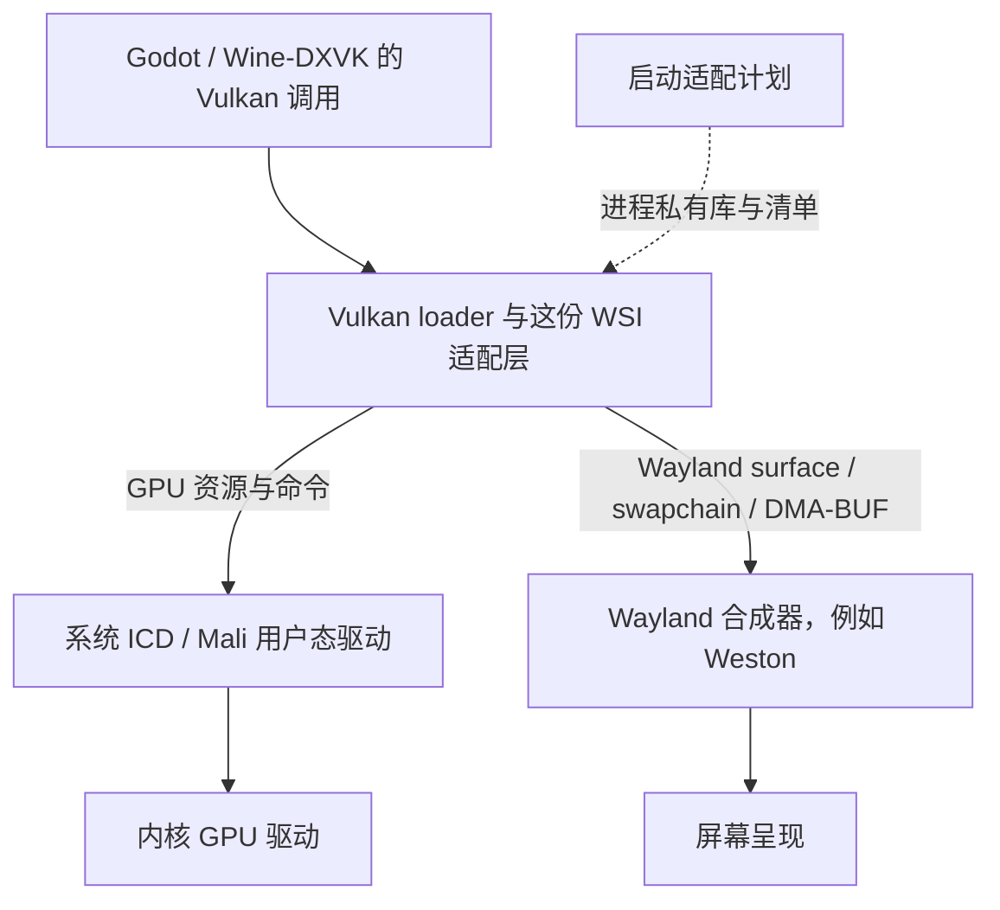

# ARM64 Wayland Vulkan WSI

## 目的与层级

这是一份原生 Linux 用户态的 **Vulkan Window System Integration（WSI）适配库**。
它补充 Vulkan 到 Wayland 的窗口表面、交换链和呈现支持，连接应用的 Vulkan 调用、
系统 GPU 驱动以及 Wayland 合成器。实际 GPU 绘制仍由系统 ICD/驱动执行。

它不包含完整 Godot、Wine 或 Unity 引擎，不替换 GPU 驱动，不把硬件 Vulkan 版本
升级到清单上标注的版本，也不处理 OpenGL 的逐绘图调用 `glFinish`。

## 当前归档的身份与来源

| 项目 | 值 |
|---|---|
| 文件 | `libVkLayer_window_system_integration.so` |
| 大小 | 352,096 字节，约 343.8 KiB |
| SHA256 | `ed454d770a5908d94875ab5cf60b6b0d428fe9b31b8e87311ed0c1f928db0cc8` |
| 格式 | Linux ELF64，小端，AArch64 共享库 |
| 许可 | MIT，Arm Limited 2019，见 `LICENSE` |
| 上游 | [GinKage/vulkan-wsi-layer](https://github.com/GinKage/vulkan-wsi-layer/tree/40cfec09d0e2d42c5e1f2642cf4cba11e7008112) |
| 固定源码 | `40cfec09d0e2d42c5e1f2642cf4cba11e7008112` |

此归档与项目已有 Wine 构建产物逐字节一致，未额外重新编译。
[原构建记录](../../../ports/wine-loongos/src/runtime-patches/BUILD.md) 固定了源码归档、
工具链镜像、CMake 参数和构建边界；[原来源清单](../../../ports/wine-loongos/runtime-sources.json)
记录了同一二进制和补丁校验值。

两份补丁的冻结副本在 `patches/`：

- `wsi-ext-timestamps.patch`：适配旧 RK3566 g13 驱动的校准时间戳 EXT/KHR 接口。
- `wsi-first-frame.patch`：通过 Wayland 帧回调通知 Wine runner 首帧已显示；只有设置了
  合法的 `WINE_RUNNER_PRESENT_TOKEN` 才写 `/work/presentation-ready`。普通 Godot
  会话不设置该变量，不需要 Wine runner 或它的通知文件。

## ABI 与系统要求

实际检查保存在 `abi-report.txt`，以 ELF 中的版本需求为准：

| 要求 | 当前值 |
|---|---|
| glibc 版本符号上限 | **GLIBC_2.30**，由 `pthread_cond_clockwait` 引入；不是仅需 2.17 |
| libstdc++ 版本符号上限 | **GLIBCXX_3.4.22** |
| C++ ABI 版本符号上限 | **CXXABI_1.3.9** |
| CPU/系统 | AArch64 Linux glibc ABI；不适用于 ARM32、musl、Android bionic 或 macOS |
| 直接依赖 | `libwayland-client.so.0`、`libstdc++.so.6`、`libm.so.6`、`libgcc_s.so.1`、`libpthread.so.0`、`libc.so.6` |
| 显示与内存 | Wayland；本构建使用 `system-uncached` DMA-BUF heap，需要实际内核设备、权限及相应 Vulkan 扩展 |

glibc 较新通常可提供这些版本符号，但仍需满足其他库、内核内存分配和 GPU 扩展要求。
glibc 的数字较低不等于所有 Linux 掌机都能加载并正常出画面。

## 谁已验证过

- 迷你龙 RK3566 RK817 LP4X 板、原厂 LoongOS 的 Mali-G52 g13p0：Godot 4.3 原生
  Wayland + Vulkan Mobile。已核对板型、运行时、扩展、启动后端及文件哈希，玩家反馈
  约 42 FPS；不代表所有固件或完整玩法流程均已验收。
- Wine 的原始 LoongOS 1.4.0.36 环境记录为原生呈现验证；并非每个 Wine 游戏均验证。
- 当前不据此认定吹米、其他 GPU、Godot SDL2 构建或 Unity/Rudroid 可直接替换成这份库。

## 加载清单各做什么

**先选技术栈与实际固件，再选清单；同名 `.so` 不等于任意清单都通用。**

| 文件 | 用途 |
|---|---|
| `VkLayer_window_system_integration.json` | 保存 Wine 构建原始完整清单，保持其原始声明；它包含较新的扩展，不能直接当作旧 Godot 加载器的通用清单 |
| `manifests/godot-implicit-template.json` | 旧加载器使用的精简 Godot 隐式层模板；库路径为待替换占位符，使用独立的应用启用/禁用变量 |

Godot 接入时：

1. 优先验证固件原生 Wayland Vulkan 支持，已有可用实现时使用原生路径。
2. 确认这份库适用于当前组合后，把经过 SHA256 校验的 ELF 放入应用私有、可执行映射的
   目录；SD 卡 `noexec` 环境需要已验证的私有执行视图或按哈希暂存方案。
3. 将模板的 `@PORTKIT_WSI_LIBRARY@` 替换为该 ELF 的绝对路径，写入应用自己的
   `XDG_DATA_HOME/vulkan/implicit_layer.d/`。保留原有存档根，不把 XDG 改到公共临时目录。
4. 仅目标游戏子进程设置 `PORTKIT_GODOT_WSI=1`。模板的禁用变量是
   `PORTKIT_DISABLE_GODOT_WSI=1`。如果必须绕过原厂旧的 WSI，原厂的
   `DISABLE_WSI_LAYER=1` 也只在该子进程设置，不能写进系统配置。
5. 使用原始 `VK_LAYER_window_system_integration` 层名，不随意重命名编译时的层身份；
   不把两份清单同时放进同一活动搜索目录。预检通过后仍需验证画面、输入、音频与退出。

Wine 组件打包器 `ports/wine-loongos/src/scripts/build-runtime.py` 已接受预编译 `wsi`
输入。将构建输入 JSON 的 `wsi` 指向本目录，即可使用这里的 ELF 与原始 Wine 清单，
无需再次编译这份 WSI。其他输入和组件打包流程保持独立。

出错时退出这个私有加载方案，保留系统文件和原存档；在该游戏已支持的后端配置中选择
原生/GLES 回退。此归档不会自动改动正在运行的游戏或启用一个未验证后端。

## 下次要不要编译

**相同 ELF、相同 ABI 与所需图形接口仍成立时，直接复制并校验即可。**

更换 IP、设备名称、游戏牌组，或仅修改加载清单与启动变量，都不要求重新编译。
新增机型首先做依赖和呈现验证，同一产物可复用，毋须按机型重复存一份。

以下变化才可能需要新构建：源码/补丁变化；目标 CPU 或 libc/C++ ABI 基线变化；
需要 X11 等本构建未包含的 WSI；内存分配或驱动接口确实需要修改实现。完整重建参数
和来源固定值在 `artifact.json.source` 与上述原构建记录中。
